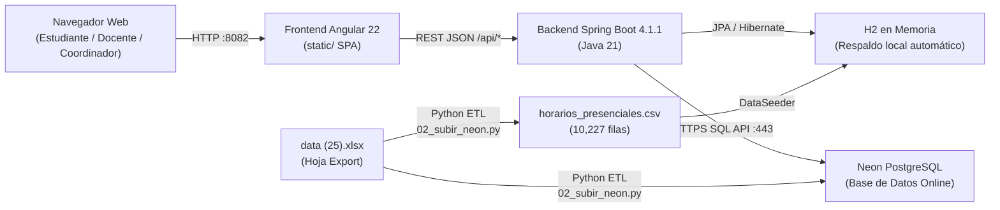

# Sistema de Verificación de Cruce de Horarios Académicos — UTP Arequipa

Aplicación web **Full-Stack** desarrollada para la **Universidad Tecnológica del Perú (UTP — Sede Arequipa · Facultad de Ingeniería)** que automatiza la consulta de horarios académicos, la reprogramación/recuperación de clases sin cruces, el cálculo de asistencia estimada de alumnos matriculados, el control de aforo por salón (`INSCRITOS <= AFORO`) y el flujo de aprobación oficial por Coordinación de Ingeniería.

---

## Tabla de Contenidos

1. [Arquitectura General](#arquitectura-general)
2. [Stack Tecnológico](#stack-tecnológico)
3. [Perfiles de Usuario y Seguridad](#perfiles-de-usuario-y-seguridad)
4. [Reglas Académicas y de Infraestructura UTP](#reglas-académicas-y-de-infraestructura-utp)
5. [Base de Datos y Pipeline ETL (`data (25).xlsx`)](#base-de-datos-y-pipeline-etl-data-25xlsx)
6. [Estructura Completa del Repositorio](#estructura-completa-del-repositorio)
7. [Vistas y Módulos del Frontend (Angular 22)](#vistas-y-módulos-del-frontend-angular-22)
8. [Catálogo Completo de Endpoints REST](#catálogo-completo-de-endpoints-rest)
9. [Pruebas Automatizadas y Calidad](#pruebas-automatizadas-y-calidad)
10. [Configuración e Instalación Local](#configuración-e-instalación-local)
11. [Guía de Ejecución y Despliegue](#guía-de-ejecución-y-despliegue)
12. [Buenas Prácticas de Seguridad](#buenas-prácticas-de-seguridad)

---

## Arquitectura General

El proyecto opera bajo una **arquitectura unificada** en el puerto `8082`: Spring Boot expone la API REST (`/api/**`), la documentación OpenAPI (`/swagger-ui.html`) y sirve directamente el bundle de producción de Angular 22 desde `src/main/resources/static/` con soporte de rutas SPA (`SpaForwardController`).



---

## Stack Tecnológico

| Capa | Tecnología | Versión / Detalle |
| :--- | :--- | :--- |
| **Backend** | Java + Spring Boot | Java `21`, Spring Boot `4.1.1` (Web, Data JPA, Validation, Actuator) |
| **Documentación API** | SpringDoc OpenAPI | `2.8.5` (Swagger UI en `/swagger-ui.html`) |
| **Frontend** | Angular | Angular `22.1` (Standalone Components, Zoneless, Signals), TypeScript `6.0`, RxJS `7.8`, SCSS |
| **Base de Datos Online** | Neon PostgreSQL | Sincronización HTTPS SQL API (`NeonSyncService`) y driver JDBC PostgreSQL |
| **Base de Datos Local** | H2 Database | Modo en memoria (`jdbc:h2:mem:testdb`) con sembrado automático vía `DataSeeder` |
| **ETL / Migración** | Python 3 + `openpyxl` | Script `02_subir_neon.py` (limpieza de Excel, exportación CSV y carga masiva a Neon) |
| **Pruebas y Cobertura** | JUnit 5 + Mockito + JaCoCo | `spring-boot-starter-test`, `jacoco-maven-plugin 0.8.12` |

---

## Perfiles de Usuario y Seguridad

El acceso se inicia directamente en `/login` con autenticación real contra `POST /api/auth/login` y protección de rutas mediante `authGuard` y `roleGuard`:

| Rol Institucional | Ejemplos de Código | Acceso y Permisos |
| :--- | :--- | :--- |
| **Estudiante** | `U23231304`, `U25000001`... | Consulta exclusiva de sus propios horarios regulares, salones asignados y recuperaciones (`/consulta-horario`, `/confirmacion`, `/base-horarios`). |
| **Docente** | `DOC-101` a `DOC-150` | Consulta de carga propia, registro de reprogramaciones con análisis de asistencia, matriz semanal de salones, base presencial y constancia (`/consulta-horario`, `/registro-reprogramacion`, `/base-horarios`, `/confirmacion`). |
| **Coordinador Académico** | `COORD-01`, `COORD-02`, `COORD-03` | Acceso total: consulta de cualquier docente/estudiante, reprogramación, aprobación o rechazo con observación, panel ejecutivo KPI, exportación CSV consolidada y gestión de horarios/matrículas (`/gestion` y todas las vistas). |

> La contraseña institucional se configura mediante la variable de entorno `APP_AUTH_PASSWORD` (no se muestra ninguna pista de contraseña en la interfaz).

---

## Reglas Académicas y de Infraestructura UTP

### 1. Franja Horaria y Hora Académica
- **Hora académica:** `45 minutos` (duraciones válidas: `45`, `90`, `135` min...; sesiones regulares estándar de `90` min = 2 horas académicas).
- **Lunes a Sábado:** `07:00 am` a `10:30 pm` (`22:30`).
- **Domingos:** `07:00 am` a `02:00 pm` (`14:00`). Las franjas posteriores se bloquean en backend y se muestran como `Cerrado (Dom. hasta 14:00)` en las matrices y calendarios.

### 2. Intervalo de Traslado Docente
- Entre el fin de una sesión y el inicio de la siguiente del mismo docente debe existir un **intervalo mínimo de `15 minutos`**.

### 3. Porcentaje de Asistencia y Recomendación Inteligente
- Al evaluar una fecha y franja de recuperación, el sistema cruza los horarios de todos los alumnos matriculados en el curso (sin duplicar estudiantes) y calcula el **porcentaje de asistencia estimada**.
- Marca como **Recomendadas** las alternativas con asistencia **> 50%**, pero mantiene visibles todas las opciones (altas y bajas) ordenadas de mayor a menor porcentaje.

### 4. Las 3 Sedes UTP Arequipa y Aulas Subterráneas (`S`)
Las aulas subterráneas se identifican colocando la letra **`S`** inmediatamente después de la letra del pabellón:

| Sede UTP Arequipa | Pabellones | Pisos Regulares | Aulas Subterráneas Permitidas | Ejemplos Válidos | Ejemplos Rechazados |
| :--- | :---: | :---: | :---: | :--- | :--- |
| **Sede Tacna y Arica** | `A`, `B` | Piso `1`–`9` | Solo **Sótano `-1`** (`S1xx`) | `A101`, `B204`, `AS101`, `BS102` | `AS201`, `BS202` |
| **Sede Parra 1** | `C`, `D`, `E`, `F`, `G` | Piso `1`–`9` | **Sótano `-1` y `-2`** (`S1xx`, `S2xx`) | `C302`, `CS101`, `DS201`, `GS0104` | `CS301`, `DS302` |
| **Sede Parra 2** | `H`, `I` | Piso `1`–`9` | **Sótano `-1` y `-2`** (`S1xx`, `S2xx`) | `H203`, `HS101`, `HS201`, `IS202` | `HS301`, `IS301` |

### 5. Disponibilidad de Salón y Capacidad (`INSCRITOS <= AFORO`)
- **`AFORO`:** capacidad máxima física del salón (`CLASE`).
- **`INSCRITOS`:** número de estudiantes matriculados que asisten a la sesión.
- Al validar o reprogramar una clase, el sistema comprueba:
  1. Que el salón (`CLASE`) no esté ocupado en ese día y franja (`DIA_CLASE`, `HORA INICIO`, `HORA FIN`).
  2. Que `INSCRITOS <= AFORO`. Si `INSCRITOS > AFORO`, muestra una alerta de capacidad insuficiente y sugiere salones libres con aforo suficiente en esa misma franja.

---

## Base de Datos y Pipeline ETL (`data (25).xlsx`)

### Esquema de Tablas
1. **`docentes`**: `53` registros (`50` docentes `DOC-101..DOC-150` + `3` coordinadores `COORD-01..COORD-03`).
2. **`estudiantes`**: `3,000` registros con nombres completos y códigos institucionales.
3. **`horarios`**: `102` cursos/secciones regulares distribuidos en las 3 sedes (incluyendo aulas subterráneas `AS101`, `BS102`, `CS101`, `CS201`, `DS201`, `HS101`, `HS201`, `IS202`).
4. **`matriculas`**: `3,494` inscripciones sin duplicados por curso (mínimo 15 estudiantes por curso).
5. **`reprogramaciones`**: solicitudes de recuperación con `estado` (`SOLICITADO`, `CONFIRMADO`, `RECHAZADO`), `motivo`, `observacion_coordinador` y `porcentaje_asistencia`, sincronizadas en tiempo real con Neon PostgreSQL.
6. **`horarios_presenciales`**: **`10,227` registros completos** importados desde `data (25).xlsx` (hoja `Export`).

### Reglas del Script ETL (`02_subir_neon.py`)
- Lee `data (25).xlsx` (hoja `Export`) tomando la **fila 1** como cabeceras exactas.
- Descarta automáticamente las **2 filas finales** de pie de página/filtros (`COD_CURSO` o `CURSO` nulos), conservando exactamente **10,227 registros válidos**.
- **Ignora 4 columnas:** `NUM_CLASE`, `MODULO`, `EDIFICIO`, `CATEGORIA`.
- **Conserva 19 columnas:** `COORDINADOR_CURSO`, `COD_DOCENTE`, `NOM_DOCENTE`, `COD_CURSO`, `CURSO`, `CATALOGO`, `CICLO`, `SECCION`, `CARRERA`, `MODALIDAD`, `TIPO_CLASE`, `AFORO`, `INSCRITOS`, `GRADO`, `DIA_CLASE`, `HORA INICIO`, `HORA FIN`, `HORAS_PROG`, `CLASE` (admitiendo `NULL` en `COORDINADOR_CURSO`, `COD_DOCENTE`, `NOM_DOCENTE` y `TIPO_CLASE`).
- **Limpieza de `CLASE`:** aplica `str(valor).strip()[2:]` para quitar los 2 primeros caracteres (ej. `38A0102` → `A0102`, `38A0111` → `A0111`, `84J0202` → `J0202`, `77GS0104` → `GS0104`), generando `441` códigos de aula limpios únicos.
- Exporta `src/main/resources/data/horarios_presenciales.csv` para el respaldo automático en H2 y carga todos los registros a Neon PostgreSQL verificando `SELECT COUNT(*) = 10227`.

---

## Estructura Completa del Repositorio

```text
Cruce_de_Horario/
├── README.md                                # Documentación integral del proyecto
├── 02_subir_neon.py                         # Pipeline ETL: Excel -> CSV H2 + Neon PostgreSQL
├── .env.example                             # Plantilla de variables de entorno (sin credenciales)
├── .gitignore                               # Excluye .env, .env.local, target/, node_modules/, etc.
├── pom.xml                                  # Dependencias Maven, Spring Boot 4.1.1 y JaCoCo
├── mvnw / mvnw.cmd                          # Maven Wrapper multiplataforma
├── src/
│   ├── main/java/utp/edu/pe/cruce_horarios/
│   │   ├── CruceHorariosApplication.java
│   │   ├── config/
│   │   │   ├── DataSeeder.java              # Carga inicial en H2 + sincronización de reprogramaciones
│   │   │   └── OpenApiConfig.java           # Metadatos Swagger / OpenAPI
│   │   ├── controller/
│   │   │   ├── AuthController.java          # Login por rol institucional
│   │   │   ├── DocenteController.java       # Gestión y consulta de docentes
│   │   │   ├── EstudianteController.java    # Gestión y consulta de estudiantes
│   │   │   ├── HorarioController.java       # Horarios, matrículas, disponibilidad, recomendaciones y reprogramaciones
│   │   │   ├── HorarioPresencialController.java # Consulta paginada (10,227 filas), aulas y validador AFORO/INSCRITOS
│   │   │   └── SpaForwardController.java    # Forward de rutas Angular a index.html
│   │   ├── model/                           # Docente, Estudiante, Horario, HorarioPresencial, Matricula, Reprogramacion
│   │   ├── repository/                      # Repositorios JPA
│   │   └── service/
│   │       ├── CruceHorarioService.java     # Motor de reglas académicas, cruces, sedes y aforo
│   │       └── NeonSyncService.java         # Cliente HTTPS SQL API para Neon PostgreSQL
│   ├── main/resources/
│   │   ├── application.properties           # Configuración sin secretos (lee .env opcional)
│   │   ├── data/                            # docentes.csv, estudiantes.csv, horarios.csv, matriculas.csv, aulas.csv, horarios_presenciales.csv
│   │   └── static/                          # Build de producción de Angular servido por Spring Boot
│   └── test/java/utp/edu/pe/cruce_horarios/
│       ├── CruceHorariosApplicationTests.java
│       └── CruceHorarioServiceTest.java     # Pruebas unitarias de cruces, 45 min, domingo, 3 sedes y recomendaciones
└── frontend-horarios/                       # Aplicación SPA Angular 22 (ver frontend-horarios/README.md)
```

---

## Vistas y Módulos del Frontend (Angular 22)

| Ruta | Componente | Funcionalidad Principal |
| :--- | :--- | :--- |
| `/login` | `AccesoRegistroComponent` | Selección de rol, autocompletado rápido de código institucional y validación real en backend. |
| `/consulta-horario` | `ConsultaHorarioComponent` | Consulta de horarios regulares y recuperaciones con cambio instantáneo entre **Vista Tabla** y **Calendario Semanal (Lun–Dom)**, mostrando Sede y Piso/Sótano por aula. |
| `/registro-reprogramacion` | `RegistroReprogramacionComponent` | Formulario con validación en vivo (rango horario, traslado 15 min, 3 sedes/sótanos, `INSCRITOS <= AFORO`), tabla de recomendaciones (`> 50%` y `≤ 50%`) y matriz semanal de salones filtrable por Sede y Salón. |
| `/base-horarios` | `BasePresencialComponent` | Explorador paginado de los `10,227` registros importados de Excel (KPIs, búsqueda, filtro por día y sobrecupo, barras `INSCRITOS / AFORO`) + **Validador de Salón y Capacidad** en tiempo real con aulas sugeridas. |
| `/confirmacion` | `ConfirmacionComponent` | Constancia oficial imprimible (`@media print`), matriz semanal, confirmación/rechazo con observación (Coordinador) y exportación CSV con columna `Sede / Nivel`. |
| `/gestion` | `GestionUsuariosComponent` | Panel ejecutivo del Coordinador: KPIs de solicitudes, aprobación/rechazo con observación, reporte consolidado CSV, alta de docentes/estudiantes, asignación de horarios regulares y matrículas. |

---

## Catálogo Completo de Endpoints REST

### Autenticación, Docentes y Estudiantes
| Método | Endpoint | Descripción |
| :--- | :--- | :--- |
| `POST` | `/api/auth/login` | Valida perfil, código y contraseña institucional |
| `GET` | `/api/docentes` | Lista todos los docentes y coordinadores |
| `GET` | `/api/docentes/{codigo}` | Busca un docente por código |
| `POST` | `/api/docentes` | Registra o identifica un docente/coordinador |
| `GET` | `/api/estudiantes` | Lista el padrón de estudiantes |
| `GET` | `/api/estudiantes/{codigo}` | Busca un estudiante por código |
| `POST` | `/api/estudiantes` | Registra o identifica un estudiante |

### Horarios, Matrículas y Reprogramaciones
| Método | Endpoint | Descripción |
| :--- | :--- | :--- |
| `GET` | `/api/horarios` | Lista todos los horarios regulares |
| `GET` | `/api/horarios/{codigo}` | Horario regular de un docente |
| `GET` | `/api/horarios/estudiantes/{codigo}` | Horario regular de un estudiante |
| `POST` | `/api/horarios` | Registra un horario regular validando reglas académicas y sede |
| `GET` | `/api/horarios/matriculas` | Lista matrículas registradas |
| `POST` | `/api/horarios/matriculas` | Registra matrícula evitando duplicados |
| `POST` | `/api/horarios/disponibilidad-presencial` | Calcula porcentaje de asistencia y lista de estudiantes con cruce |
| `GET` | `/api/horarios/recomendaciones?docenteCodigo=&curso=` | Devuelve opciones de fecha/hora ordenadas por `%` de asistencia |
| `GET` | `/api/horarios/reprogramaciones` | Lista todas las reprogramaciones |
| `GET` | `/api/horarios/reprogramaciones/{codigo}` | Reprogramaciones de un docente |
| `GET` | `/api/horarios/reprogramaciones/estudiantes/{codigo}` | Reprogramaciones de los cursos de un estudiante |
| `POST` | `/api/horarios/reprogramaciones` | Valida reglas académicas, sede, disponibilidad y aforo, y registra solicitud |
| `PUT` | `/api/horarios/reprogramaciones/{id}/confirmar` | Confirma oficialmente una solicitud y la sincroniza en Neon |
| `PUT` | `/api/horarios/reprogramaciones/{id}/rechazar` | Rechaza con observación una solicitud y la sincroniza en Neon |
| `DELETE` | `/api/horarios/reprogramaciones/{id}` | Elimina una reprogramación en H2 y Neon |

### Base Presencial (`data (25).xlsx` — 10,227 registros)
| Método | Endpoint | Descripción |
| :--- | :--- | :--- |
| `GET` | `/api/horarios-presenciales` | Consulta paginada (`q`, `dia`, `clase`, `soloSobrecupo`, `page`, `size`) |
| `GET` | `/api/horarios-presenciales/resumen` | Total de registros (`10,227`), aulas limpias (`441`), sobrecupos y muestra |
| `GET` | `/api/horarios-presenciales/aulas` | Catálogo completo de salones limpios (`CLASE`) con su `AFORO` |
| `POST` | `/api/horarios-presenciales/validar-asignacion` | Valida cruce de aula + `INSCRITOS <= AFORO` y sugiere salones libres aptos |

---

## Pruebas Automatizadas y Calidad

La suite de pruebas en `CruceHorarioServiceTest` y `CruceHorariosApplicationTests` cubre:
- Arranque completo del contexto Spring Boot y sembrado de H2 (`10,227` horarios presenciales + catálogo académico).
- Detección de cruces de horario docente y de estudiantes matriculados.
- Validación de bloques de `45` min, franja Lun–Sáb `07:00–22:30`, franja Domingo `07:00–14:00` y traslado mínimo de `15` min.
- Validación de las 3 sedes UTP y límites de sótanos (`AS101` válido, `AS201` rechazado, `CS201`/`HS201` válidos, `CS301`/`IS301`/`J402` rechazados).
- Cálculo de disponibilidad presencial parcial y ordenamiento de recomendaciones (`> 50%` y `≤ 50%`).

Ejecutar las pruebas y generar reporte de cobertura JaCoCo (`target/site/jacoco/index.html`):
```cmd
mvnw.cmd test
```

---

## Configuración e Instalación Local

### Requisitos Previos
- **JDK 21** instalado y en `PATH` (`java -version`).
- **Node.js 20+** y **npm** (solo si vas a modificar/compilar el frontend Angular).
- **Python 3.10+** con `openpyxl` (solo si vas a re-ejecutar `02_subir_neon.py`).

### Variables de Entorno (Opcional para Neon PostgreSQL)
1. Copia `.env.example` a `.env` en la raíz del proyecto:
   ```powershell
   Copy-Item .env.example .env
   ```
2. Edita `.env` con tus credenciales reales (el archivo `.env` está en `.gitignore` y nunca se sube a Git):
   - `NEON_SYNC_ENABLED=true`, `NEON_HTTP_URL`, `NEON_CONNECTION_STRING` para sincronización online HTTPS (puerto 443).
   - `APP_AUTH_PASSWORD` para personalizar la contraseña institucional.
3. Si no configuras `.env`, el proyecto arranca directamente con **H2 en memoria** sin pasos adicionales.

---

## Guía de Ejecución y Despliegue

### 1. Arrancar el Sistema Completo (Backend + Frontend Unificado)
Desde la raíz del proyecto (`Cruce_de_Horario`):
```cmd
mvnw.cmd spring-boot:run
```
URLs disponibles:
- **Aplicación Web:** `http://localhost:8082`
- **Swagger UI (API):** `http://localhost:8082/swagger-ui.html`
- **Health Check:** `http://localhost:8082/actuator/health`

### 2. Recompilar el Frontend Angular y Actualizar Estáticos
```powershell
cd frontend-horarios
npm install
npx ng build
```
Copia el contenido de `frontend-horarios/dist/frontend-horarios/browser/` hacia `src/main/resources/static/` y reinicia Spring Boot.

### 3. Reimportar `data (25).xlsx` (hoja `Export`)
Coloca `data (25).xlsx` en la raíz o en `Downloads` (o define `EXCEL_DATA_PATH`) y ejecuta:
```powershell
python 02_subir_neon.py
```

---

## Buenas Prácticas de Seguridad

- Ninguna contraseña o cadena de conexión real se guarda en el repositorio; `.env` y `.env.local` permanecen excluidos en `.gitignore`.
- Tanto `NeonSyncService.java` como `02_subir_neon.py` enmascaran automáticamente las credenciales en logs y salidas de consola (`********`).
- `application.properties` sanitiza las claves sensibles en los endpoints de Actuator (`management.endpoint.env.additional-keys-to-sanitize`).
